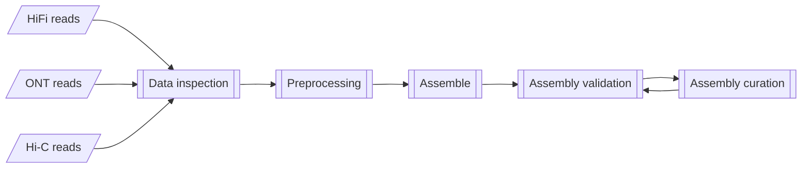

# Earth Biogenome Project - Pilot Workflow

The primary workflow for the Earth Biogenome Project Pilot at NBIS.

## Workflow overview

General aim:



Current implementation:

```mermaid
flowchart TD
    %% Input
    input[/ Input files /] --> hifi[/ HiFi reads /]
    input --> hic[/ Hi-C reads /]

    subgraph metadata[" METADATA FETCHING "]
        taxquery[[ ENA taxonomic query ]]
        goat[[ GOAT taxon search ]]
        tol_search[[ ToL search ]]
        taxquery --> goat
        goat --> tol_search
    end

    input --> taxquery

    subgraph preprocess[" PREPROCESSING "]
        direction TB
        subgraph hifi_prep[" HiFi Processing "]
            samtools_fa[[ Samtools fasta ]]
            merge_pacbio[[ Merge PacBio ]]
            samtools_fa --> merge_pacbio
        end

        subgraph hic_prep[" Hi-C Processing "]
            fastp[[ Fastp ]]
            samtools_import[[ Samtools import ]]
            samtools_index[[ Samtools index ]]
            fastp --> samtools_import
            samtools_import --> samtools_index
        end
    end

    hifi --> samtools_fa
    hic --> fastp

    subgraph kmer_db[" K-MER DATABASES "]
        direction TB
        subgraph fastk_build[" FastK "]
            fastk[[ FastK ]]
            fastk_merge[[ FastK merge ]]
            fastk --> fastk_merge
        end

        subgraph meryl_build[" Meryl "]
            meryl_count[[ Meryl count ]]
            meryl_unionsum[[ Meryl unionsum ]]
            meryl_hist[[ Meryl histogram ]]
            meryl_count --> meryl_unionsum
            meryl_unionsum --> meryl_hist
        end
    end

    merge_pacbio --> fastk
    merge_pacbio --> meryl_count
    samtools_index --> fastk
    samtools_index --> meryl_count

    subgraph inspect[" DATA INSPECTION "]
        direction TB
        subgraph basic_stats[" Basic Statistics "]
            seqkit[[ SeqKit Stats ]]
            fastqc[[ FastQC ]]
        end

        subgraph genome_props[" Genome Properties "]
            histex[[ Histex ]]
            genescopefk[[ GeneScopeFK ]]
            smudgeplot[[ Smudgeplot ]]
            katgc[[ KatGC ]]
            histex --> genescopefk
        end

        subgraph lib_compare[" Library Comparison "]
            katcomp[[ KatComp ]]
        end
    end

    merge_pacbio --> seqkit
    samtools_index --> seqkit
    samtools_index --> fastqc
    fastk_merge --> histex
    fastk_merge --> smudgeplot
    fastk_merge --> katgc
    fastk_merge --> katcomp

    subgraph assemble[" ASSEMBLY "]
        direction TB
        subgraph hifiasm_asm[" HiFiasm Assembly "]
            hifiasm[[ HiFiasm ]]
            gfa2fa[[ GFA2FA ]]
            hifiasm --> gfa2fa
        end

        subgraph organelles[" Organelle Assembly "]
            direction LR
            oatkdb[( OATK HMM database )]
            oatk_selecthmm[[ OATK SelectHMM ]]
            oatk[[ OATK ]]
            mitoref[[ Mitohifi - Find reference ]]
            mitohifi[[ Mitohifi ]]
            oatkdb --> oatk_selecthmm
            oatk_selecthmm --> oatk
            mitoref --> mitohifi
        end
    end

    merge_pacbio --> hifiasm
    merge_pacbio --> oatk
    merge_pacbio --> mitoref
    merge_pacbio --> mitohifi
    goat --> oatk_selecthmm
    goat --> mitoref

    subgraph decontam[" DECONTAMINATION "]
        direction LR
        fcs_db[( FCS GX database )]
        fcsgx_fetch[[ FCS GX fetchdb ]]
        fcsgx[[ FCS GX ]]
        fcsgx_clean[[ FCS GX clean ]]
        fcs_db --> fcsgx_fetch
        fcsgx_fetch --> fcsgx
        fcsgx --> fcsgx_clean
    end

    gfa2fa --> fcsgx

    subgraph purge[" PURGE DUPLICATES "]
        purgedups[[ Purge duplicates ]]
    end

    fcsgx_clean --> purgedups
    merge_pacbio --> purgedups

    subgraph scaffold[" SCAFFOLDING "]
        direction TB
        subgraph index_prep[" Index Preparation "]
            bwamem2_index[[ BWA-MEM2 index ]]
            samtools_faidx[[ Samtools faidx ]]
            chromsizes[[ Extract chromsizes ]]
            samtools_faidx --> chromsizes
        end

        subgraph hic_map[" Hi-C Mapping "]
            bwamem2_mem[[ BWA-MEM2 mem ]]
            pairtools[[ Pairtools ]]
            bwamem2_mem --> pairtools
        end

        subgraph yahs_scaf[" YAHS Scaffolding "]
            yahs[[ YAHS ]]
            merge_haps[[ Merge haplotypes ]]
            yahs --> merge_haps
        end
    end

    purgedups --> bwamem2_index
    purgedups --> samtools_faidx
    bwamem2_index --> bwamem2_mem
    samtools_index --> bwamem2_mem
    chromsizes --> pairtools
    pairtools --> yahs
    purgedups --> yahs

    subgraph evaluate[" ASSEMBLY EVALUATION "]
        direction TB
        merquryfk[[ MerquryFK ]]
        merqury[[ Merqury ]]
        busco[[ BUSCO ]]
        gfastats[[ GFAstats ]]
        quast[[ QUAST ]]
    end

    gfa2fa --> merquryfk
    fastk_merge --> merquryfk
    fcsgx_clean --> merquryfk
    purgedups --> merquryfk
    yahs --> merquryfk

    gfa2fa --> merqury
    meryl_unionsum --> merqury
    fcsgx_clean --> merqury
    purgedups --> merqury
    yahs --> merqury

    goat --> busco
    gfa2fa --> busco
    fcsgx_clean --> busco
    purgedups --> busco
    yahs --> busco

    gfa2fa --> gfastats
    fcsgx_clean --> gfastats
    purgedups --> gfastats
    yahs --> gfastats

    gfa2fa --> quast
    fcsgx_clean --> quast
    purgedups --> quast
    yahs --> quast
    %% Each stage runs its own evaluation (pipelines/assembly_qc). QUAST compares the assemblies of all stages (pipelines/compare_stages)

    subgraph report[" REPORTING "]
        direction TB
        report_genometraits[[ Report genome traits ]]
        report_versions[[ Report software versions ]]
        quarto[[ Quarto notebook ]]
        output[/ Final report /]
        report_genometraits --> quarto
        report_versions --> quarto
        quarto --> output
    end

    tol_search --> quarto
    goat --> report_genometraits
    busco --> report_versions
    genescopefk --> quarto
    smudgeplot --> quarto
    katgc --> quarto
    katcomp --> quarto
    seqkit --> quarto
    fastqc --> quarto
    gfastats --> quarto
    merquryfk --> quarto
    merqury --> quarto
    busco --> quarto
    quast --> quarto
    oatk --> quarto
    mitohifi --> quarto
```



## Usage

Requires Nextflow >= 26.10.3. If you are updating from v1.0.0, read the
[migration guide](docs/migration-typed-records.md): the input YAML has the same keys, but HiFi reads are now required, `--input` takes one file, and the
published folders, process names and `ext.when` are not.

```bash
nextflow run -params-file <params.yml> \
    [ -c <custom.config> ] \
    [ -profile <profile> ] \
    NBISweden/Earth-Biogenome-Project-pilot
```

where:
- `params.yml` is a YAML formatted file containing workflow parameters
    such as input paths to the assembly specification, and settings for tools within the workflow.

    Example:

    ```yml
    input: 'assembly_spec.yml'
    outdir: results
    fastk: # Optional
      kmer_size: 31 # default 31
    genescopefk: # Optional
      kmer_size: 31 # default 31
    hifiasm: # Optional, default = no extra options: Key (e.g. 'opts01') is used in assembly build name (e.g., 'hifiasm-raw-opts01').
      opts01: "--opts A"
      opts02: "--opts B"
    busco: # Optional, default: retrieved by GOAT_TAXONSEARCH
      lineages: 'auto' # comma separated string of lineages or auto.
    ```

    Alternatively parameters can be provided on the
    command-line using the `--parameter` notation (e.g., `--input <path>` ).
- `<custom.config>` is a Nextflow configuration file which provides
    additional configuration. This is used to customise settings other than
    workflow parameters, such as cpus, time, and command-line options to tools.

    Example:
    ```nextflow
    process {
        withName: 'BUSCO' {  // Selects the process to apply settings.
            cpus     = 6     // Overrides cpu settings defined in nextflow.config
            time     = 4.d   // Overrides time settings defined in nextflow.config to 4 days. Use .h for hours, .m for minutes.
            memory   = '20GB'  // Overrides memory settings defined in nextflow.config to 20 GB.
            // ext.args supplies command-line options to the process tool
            // overrides the options the workflow sets
            ext.args = '--long'  // Supplies these as command-line options to Busco
        }
    }
    ```
- `<profile>` is one of the preconfigured execution profiles
    (`<cluster_specific_profile>`, `singularity`, `docker`, etc: see nextflow.config). Alternatively,
    you can provide a custom configuration to configure this workflow
    to your execution environment. See [Nextflow Configuration](https://www.nextflow.io/docs/latest/config.html#scope-executor)
    for more details.

### Workflow parameter inputs

Mandatory:

- `input`: A YAML formatted input file.
    Example `assembly_spec.yml` (See also [test profile input](assets/test_hsapiens.yml) TODO:: Update test profile):

    ```yml
    sample:                          # Required: Meta data
      name: 'Laetiporus sulphureus'  # Required: Species name. Correct spelling is important to look up species information.
      ploidy: 2                      # Optional: Estimated ploidy (default: retrieved by GOAT_TAXONSEARCH)
      genome_size: 2345              # Optional: Estimated genome size (default: retrieved by GOAT_TAXONSEARCH)
      haploid_number: 13             # Optional: Estimated haploid chromosome count (default: retrieved by GOAT_TAXONSEARCH)
      tax_id: 5630                   # Optional: Taxon ID (default: retrieved from ENA)
      genetic_code: 1                # Optional: Genetic code (default: retrieved from ENA)
      mito_code: 1                   # Optional: Mitochondrial genetic code (default: retrieved from ENA)
      domain: Eukaryota              # Optional: (default: retrieved from ENA)
    assembly:                        # Optional: List of assemblies to curate and validate.
      - assembler: hifiasm           # For each entry, the assembler,
        stage: raw                   # stage of assembly (raw, decontaminated, purged, polished, scaffolded, curated),
        id: uuid                     # unique id,
        pri_fasta: /path/to/primary_asm.fasta # and paths to sequences are required.
        alt_fasta: /path/to/alternate_asm.fasta
        pri_gfa: /path/to/primary_asm.gfa
      - assembler: ipa
        stage: raw
        id: uuid
        pri_fasta: /path/to/primary_asm.fasta
        alt_fasta: /path/to/alternate_asm.fasta
    hic:                             # Optional: List of hi-c reads to QC and use for scaffolding
      - read1: '/path/to/raw/data/hic/LS_HIC_R001_1.fastq.gz'
        read2: '/path/to/raw/data/hic/LS_HIC_R001_2.fastq.gz'
    hifi:                            # Required: List of hifi-reads to QC and use for assembly/validation
      - reads: '/path/to/raw/data/hifi/LS_HIFI_R001.bam'
    rnaseq:                          # Optional: List of Rna-seq reads to use for validation
      - read1: '/path/to/raw/data/rnaseq/LS_RNASEQ_R001_1.fastq.gz'
        read2: '/path/to/raw/data/rnaseq/LS_RNASEQ_R001_2.fastq.gz'
    isoseq:                          # Optional: List of Isoseq reads to use for validation
      - reads: '/path/to/raw/data/isoseq/LS_ISOSEQ_R001.bam'
    ```

Optional:

- `outdir`: The publishing path for results (default: `results`).
- `publish_mode`: (values: `'copy'` (default), `'symlink'`) The file
publishing method from the intermediate results folders
(see the [`workflow.output.mode` documentation](https://www.nextflow.io/docs/latest/reference/config.html#workflow)).
- `steps`: The workflow steps to execute (default is all steps). Choose from:

    - `inspect`: 01 - Read inspection
    - `preprocess`: 02 - Read preprocessing
    - `assemble`: 03 - Assembly
    - `screen`: 04 - Contamination screening
    - `purge`: 05 - Duplicate purging
    - `polish`: 06 - Error polishing (TODO: In development)
    - `scaffold`: 07 - Scaffolding
    - `curate`: 08 - Rapid curation
    - `alignRNA`: 09 - Align RNAseq data

Software specific:

Tool specific settings are provided by supplying values to specific keys or supplying an array of
settings under a tool name. The input to `-params-file` would look like this:

```yml
input: assembly.yml
outdir: results
fastk:
  kmer_size: 31
genescopefk:
  kmer_size: 31
hifiasm:
  opts01: "--opts A"
  opts02: "--opts B"
busco:
  lineages: 'auto'
```

- `multiqc_assembly_report_config`: Path to the MultiQC configuration file of the assembly report (default: `configs/multiqc_assembly_report_config.yml`).

### Workflow outputs

All results are published to the path assigned to the workflow parameter `outdir`.

Each stage folder has one subfolder per sample (read stages) or per assembly build (assembly stages),
with the tools inside. The assembly QC of a build is in `qc/`.

<details>
<summary>Expand for example results directory structure</summary>
<pre>
results
├── 01_read_inspection
│   └── Drosophila_melanogaster
│       ├── dtol_search
│       ├── fastk
│       ├── fastqc_hic
│       ├── genescopefk
│       ├── kat_comp
│       ├── katgc
│       ├── seqkit_hic_stats
│       ├── seqkit_hifi_stats
│       └── smudgeplot
├── 02_read_preprocessing
│   └── Drosophila_melanogaster
│       └── hic_cram
├── 03_assembly
│   ├── hifiasm-raw-default
│   │   ├── gfa2fa
│   │   ├── hifiasm
│   │   ├── organelle
│   │   └── qc
│   │       ├── busco
│   │       ├── gfastats
│   │       ├── merqury
│   │       └── merquryfk
├── 04_contamination_screen
│   ├── hifiasm-decontaminated-default
│   │   ├── fcsgx
│   │   └── qc
├── 05_duplicate_purging
│   ├── hifiasm-purged-default
│   │   ├── purge_dups
│   │   └── qc
├── 06_error_polishing
│   ├── hifiasm-polished-default
│   │   ├── dvpolish
│   │   └── qc
├── 07_scaffolding
│   ├── hifiasm-scaffolded-default
│   │   ├── merged_haps
│   │   ├── pairtools
│   │   ├── qc
│   │   └── yahs
├── 08_curation
│   └── hifiasm-curated-default
│       ├── higlass
│       └── pretext
├── 10_report
│   ├── quast/<sample>
│   ├── assembly_report.html
│   ├── assembly_report.md
│   ├── multiqc-summary.html
│   └── versions.yml
└── pipeline_info
</pre>
</details>

The paths that moved from earlier versions are listed in the [migration guide](docs/migration-typed-records.md#publishing).

### Examples

- Run the workflow with the default parameters and all steps:

  ```bash
  nextflow run NBISweden/Earth-Biogenome-Project-pilot -params-file params.yml
  ```
  where `params.yml` is a YAML file containing the workflow parameters:
  ```yml
  input: 'assembly_spec.yml'
  ```
  and `assembly_spec.yml` is a YAML file containing the assembly specification
  ```yml
  sample:
    name: 'Laetiporus sulphureus'
  hifi:
    - reads: '/path/to/raw/data/hifi/LS_HIFI_R001.bam'
  hic:
    - read1: '/path/to/raw/data/hic/LS_HIC_R001_1.fastq.gz'
      read2: '/path/to/raw/data/hic/LS_HIC_R001_2.fastq.gz'
  ```

- Run purging to curation on an existing assembly:
  ```bash
  nextflow run NBISweden/Earth-Biogenome-Project-pilot -params-file params.yml
  ```
  where `params.yml` is a YAML file containing the workflow parameters:
  ```yml
  input: 'assembly_spec.yml'
  steps: 'purge,scaffold,curate'
  ```
  and `assembly_spec.yml` is a YAML file containing the assembly specification
  ```yml
  sample:
    name: 'Laetiporus sulphureus'
  assembly:
    - assembler: hifiasm
      stage: decontaminated
      id: uuid
      pri_fasta: '/path/to/primary_asm-hifiasm-decontaminated-uuid.fasta'
  hifi:
    - reads: '/path/to/raw/data/hifi/LS_HIFI_R001.bam'
  hic:
    - read1: '/path/to/raw/data/hic/LS_HIC_R001_1.fastq.gz'
      read2: '/path/to/raw/data/hic/LS_HIC_R001_2.fastq.gz'
  ```

- Run the workflow to only run assembly evaluation.
  ```bash
  nextflow run NBISweden/Earth-Biogenome-Project-pilot -params-file params.yml
  ```
  where `params.yml` is a YAML file containing the workflow parameters:
  ```yml
  input: 'assembly_spec.yml'
  steps: 'curate'
  ```
  and `assembly_spec.yml` is a YAML file containing the assembly specification
  ```yml
  sample:
    name: 'Laetiporus sulphureus'
  # Assembly to evaluate
  assembly:
    - assembler: hifiasm
      stage: curated
      id: uuid
      pri_fasta: '/path/to/primary_asm-hifiasm-curated-uuid.fasta'
  # Include HiFi reads for Merqury
  hifi:
    - reads: '/path/to/raw/data/hifi/LS_HIFI_R001.bam'
  ```

## Workflow organization

The workflows in this folder manage the execution of your analyses
from beginning to end.

```
workflow/
 | - .github/                        Github data such as actions to run
 | - assets/                         Workflow assets such as test samplesheets
 | - bin/                            Custom workflow scripts
 | - configs/                        Configuration files that govern workflow execution
 | - dockerfiles/                    Custom container definition files
 | - docs/                           Workflow usage and interpretation information
 | - modules/                        Process definitions for tools used in the workflow
 | - pipelines/                      The assembly stages and the assembly QC, each a pipeline that runs on its own
 | - subworkflows/                   Custom workflows for the read preparation, inspection and reports
 | - types/                          Record types shared by the workflow and the pipelines
 | - tests/                          Workflow tests
 | - main.nf                         The primary analysis script
 | - nextflow.config                 General Nextflow configuration
 \ - modules.json                    nf-core file which tracks modules/subworkflows from nf-core
```

